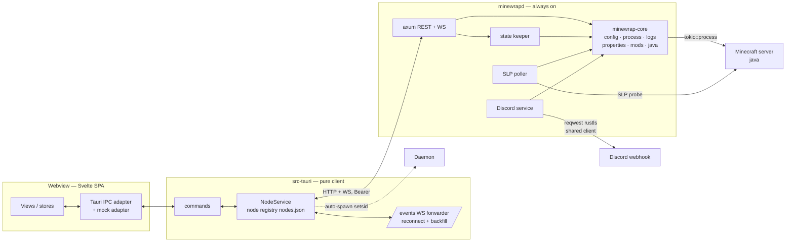
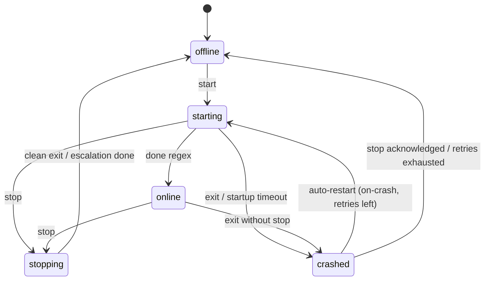

# Minewrap v2 — Architecture

**v1.10.0 (P0 daemon-first):** two binaries, one core, and the daemon is
the always-on half. `minewrapd` (axum) embeds `minewrap-core` and owns
everything that must survive the GUI closing: process lifecycles, live
state, SLP polling, Discord pushes. The Tauri app is now a **pure
client** — it links `minewrap-remote` (not `minewrap-core`), talks
REST + WS to the daemon, auto-spawns it when needed, and closing the
window only disconnects. The Svelte frontend is unchanged and still
talks only to Tauri commands/events carrying `node_id`.



## Daemon-first invariants (v1.10.0)

- **Closing the GUI never stops servers.** The exit handler is gone;
  "stop everything" is the daemon's SIGTERM path
  (`systemctl --user stop minewrapd` or `kill -TERM`), which stops
  every instance gracefully (stdin `stop` → SIGTERM → SIGKILL) and
  exits 0.
- **The GUI auto-spawns the daemon** when `/health` refuses: it looks
  for `minewrapd` next to the exe (AppImage `usr/bin`, `binaries/`),
  then `PATH`, spawns it detached (own process group, stdio appended to
  `{data_dir}/daemon.log`, `MINEWRAP_CONFIG` = the config the GUI
  loaded) and waits up to 10 s for health. Failure marks the local
  node offline with a readable error — never a crash.
- **Live state lives in the daemon**: a state keeper folds every bus
  `StateChange` into `InstanceState`, so `GET /instances` reports
  real states; a shared SLP poller probes every running instance each
  `status_poll_interval` (parallel, `unresponsive` derived after
  `unresponsive_after_failures` misses); the Discord service pushes
  state changes (leading+trailing debounce) and periodic status
  (edit-in-place / new-message) with one shared `reqwest::Client`.
- **Node registry**: remote nodes persist in
  `~/.config/minewrap/nodes.json` (0600); the local node is
  synthesized from `minewrap.toml` (`[daemon] host/port/data_dir`,
  token read from `{data_dir}/token`). The GUI parses only that table
  — it no longer links `minewrap-core`.
- **Lazy owner tasks (D2-lite)**: only `autostart` instances get an
  owner task at load; others stay config-only until their first start.
- **API is additive, version stays "1.0"**: new routes `POST
  /api/v1/instances`, `DELETE /api/v1/instances/{id}`,
  `GET /api/v1/java`, `POST /api/v1/scan-workdir`; `/events` now
  forwards `log_batch` (100 lines/40 ms, seq-tagged), `restart_loop`
  and `instances_changed` in addition to `state_change`; snapshots
  carry `last_error`.

## State machine (per instance)



A failed spawn from `offline`/`crashed` stays in the current state and
publishes a same-state `spawn_failed` event (v1.9.3 panicked the owner
task there — the instance went deaf).

Combined state merges process state and probe reachability exactly like v1:
`online` requires both; ≥N probe failures → `unresponsive`; probe failures
never produce `offline` while the process runs.

## Log pipeline

Child stdout (BufReader, UTF-8-lossy, huge lines truncated) →
bounded `mpsc` → daemon batches (40 ms / ≤100 lines) on the `/events`
WebSocket → the GUI forwarder re-emits `logs:batch` to the webview +
bounded ring for Discord/backfill. Frontend keeps the full ring
(default 1000, configurable), auto-sticks to bottom and pauses on
scroll-up. Reconnects backfill the gap via `GET …/logs?since_seq`.

## IPC command/event contract (authoritative)

All calls carry `node_id`. Errors are `MinewrapError{code, message}` with
codes `unauthorised`, `incompatible_version`, `offline`, `gone`.

### Commands (Tauri, `async`)

| Command | Args | Returns | v1 equivalent |
|---|---|---|---|
| `list_instances` | `node_id` | `InstanceSummary[]` | `GET /instances` |
| `get_snapshot` | `node_id, instance_id` | `SnapshotDto` | `GET /instances/{id}` |
| `instance_start` / `instance_stop` / `instance_restart` | `node_id, instance_id` | `Action` | `POST …/start|stop|restart` |
| `send_command` | `node_id, instance_id, command` | `Action` | `POST …/command` |
| `get_logs` | `node_id, instance_id, limit, since_seq` | `LogLine[]` | `GET …/logs` |
| `get_config` / `update_config` | `node_id, instance_id (, patch)` | `ConfigView` / `Action` | `GET/PUT …/config` |
| `add_instance` / `remove_instance` | `(config)` / `node_id, instance_id` | `Action` | `POST /instances` · `DELETE /instances/{id}` |
| `detect_java` | — | `JavaRuntime[]` | `GET /java` (v1.10.0) |
| `scan_launch` | `node_id, work_dir` | `LaunchScan` | `POST /scan-workdir` (v1.10.0) |
| `read_properties` / `write_properties` | `node_id, instance_id (, doc)` | `PropertiesDoc` | *new* |
| `list_mods` / `toggle_mod` | `node_id, instance_id (, name)` | `ModDto[]` / `Action` | *new* |
| `discord_test` | `node_id, instance_id` | `DiscordTestResponse` | `POST …/discord/test` |
| `list_nodes` / `add_node` / `remove_node` / `retry_node` | node | `Node[]` / `Node` / `Action` | gui node store |
| `health` | `node_id` | `Action` | `GET /health` |

### Events (frontend listens)

- `logs:batch` `{ node_id, instance_id, lines: [LogLine…], first_seq, last_seq }`
- `state:changed` `{ node_id, instance_id, old_state, new_state, reason }`
- `nodes:changed` `{ node_id, state? }` (v1.10.0: emitted on forwarder
  connect/disconnect and when the daemon's instance list changes)

Payload caps: ≤100 lines per batch. DTOs live in `minewrap-remote`
(shapes ported from v1.0.0 `mcpanel_common/api.py`).

## Config schema (`minewrap.toml`, schema 1)

```toml
[daemon]
host = "127.0.0.1"
port = 8080
data_dir = "./data"
token = "…"                      # read from keyring/0600 file when present
status_poll_interval = 15
unresponsive_after_failures = 2
[daemon.defaults]
startup_timeout = 300, stop_timeout = 60, kill_grace_seconds = 5
done_regex = 'Done \(\d+(\.\d+)?s\)! For help'
log_buffer_lines = 500, log_max_bytes = 10485760, log_backups = 3

[[instances]]
id = "survival"                 # ^[a-z0-9][a-z0-9_-]{0,62}[a-z0-9]$
name = "Survival"
work_dir = "/srv/minecraft/survival"
java_path = "java"
jvm_args = ["-Xms2G", "-Xmx4G"]
launch_args = ["-jar", "server.jar", "nogui"]
autostart = false               # v1.10.0: honoured by the daemon
[instances.probe]
host = "127.0.0.1", port = 25565, query_enabled = true
query_port = 25565, timeout = 3.0
[instances.restart]
policy = "on-crash"             # never | on-crash
max_retries = 5, backoff_base_seconds = 5, backoff_max_seconds = 300
reset_after_online_seconds = 600
[instances.discord]
enabled = true
webhook_url = "https://…"       # stored in the keyring/0600, exposed as webhook_set
mode = "edit-in-place"          # edit-in-place | new-message
interval_seconds = 600, first_push_delay_seconds = 10
log_lines = 15, max_log_chars = 1500
state_change_posts = true, state_change_debounce_seconds = 30
redact_regexes = []
[instances.rcon]
enabled = false                 # reserved; still unimplemented (documented)
host = "127.0.0.1", port = 25575
password_env = "MC_RCON_PASSWORD"
```

Migration from v1.x `config.toml`: fields map 1:1 except `token` and `discord.webhook_url` move to the secrets store; `data_dir`/`work_dir` resolve against the config file. Unknown keys fail loudly (`deny_unknown_fields`).

## Secrets

Tokens/webhooks in the OS keyring (Secret Service) when available, else a
`0600` file. Secrets never appear in logs, errors, UI text or git; config
writes are `0600`; webhook is write-only over the API (`webhook_set: bool`
in views). Never expose RCON. Daemon binds `127.0.0.1` by default.

## Threading / memory budget

- The daemon runs one tokio runtime (systemd unit pins
  `TOKIO_WORKER_THREADS=2`, `MALLOC_ARENA_MAX=2`) shared by the axum
  server, per-instance owner tasks, the poller and the Discord service;
  one `reqwest::Client` is shared daemon-wide.
- Owner tasks spawn lazily (autostart or first start), so N offline
  instances cost no per-instance runtime.
- The GUI keeps only client state (registry, cached connections, the
  forwarder) — its memory profile is dominated by WebKitGTK until the
  P1 pure-Rust GUI lands (that is the point of the P0 spike).
- Rust keeps only a small log ring for core needs (e.g. Discord/backfill), while the webview owns its larger console ring.

## Packaging

- `build.sh` (repo root) builds everything from source (`--daemon-only`
  for headless hosts): cargo release for `minewrapd`, `pnpm tauri
  build` for the AppImage, which bundles `binaries/minewrapd` as a
  sidecar.
- `packaging/minewrapd.service` is the systemd user unit (always-on
  daemon; SIGTERM = graceful stop-all + exit).
