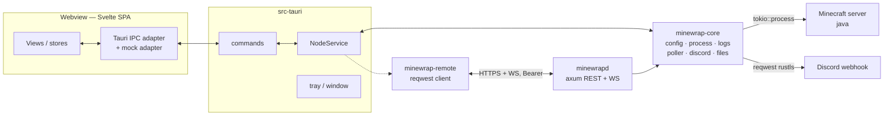
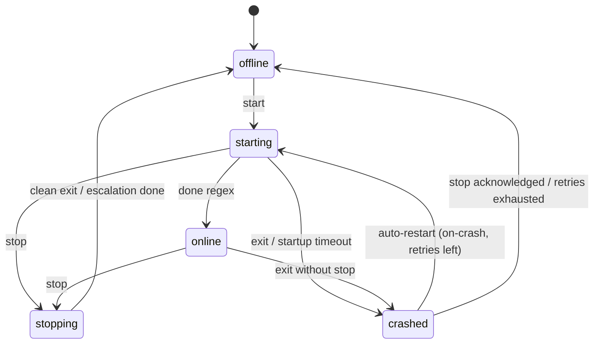

# Minewrap v2 — Architecture

Two binaries, one core. `minewrap-core` (Tauri-free) holds all server logic;
the Tauri app embeds it as the **local node**; `minewrapd` (axum) is the same
core headless for remote nodes. The Svelte frontend talks only to Tauri
commands/events carrying `node_id` — no local/remote branch in UI code.



## State machine (per instance)



Combined state merges process state and probe reachability exactly like v1:
`online` requires both; ≥N probe failures → `unresponsive`; probe failures
never produce `offline` while the process runs.

## Log pipeline

Child stdout (BufReader, UTF-8-lossy, huge lines truncated) →
bounded `mpsc` → batcher (30–50 ms or N lines) → Tauri `emit("logs:batch")`
+ bounded ring for Discord/backfill. Frontend keeps the full ring (default
1000, configurable), auto-sticks to bottom and pauses on scroll-up.

Startup bursts must not re-render the list line-by-line: appends are batched
and the DOM list is capped; WebKitGTK re-render cost is the main RSS/perf
lever.

## IPC command/event contract (authoritative)

All calls carry `node_id`. Errors are `MinewrapError{code, message}` with
codes `unauthorised`, `incompatible_version`, `offline`, `gone`.

### Commands (Tauri, `async`)

| Command | Args | Returns | v1 equivalent |
|---|---|---|---|
| `list_instances` | `node_id` | `InstanceSummary[]` | `GET /instances` |
| `get_snapshot` | `node_id, instance_id` | `InstanceSnapshot` | `GET /instances/{id}` |
| `instance_start` / `instance_stop` / `instance_restart` | `node_id, instance_id` | `Action` | `POST …/start|stop|restart` |
| `send_command` | `node_id, instance_id, command` | `CommandResponse` | `POST …/command` |
| `get_logs` | `node_id, instance_id, limit, since_seq` | `Logs` | `GET …/logs` |
| `get_config` / `update_config` | `node_id, instance_id (, update)` | `InstanceConfigView` | `GET/PUT …/config` |
| `read_properties` / `write_properties` | `node_id, instance_id (, doc)` | `PropertiesDoc` | *new* |
| `list_mods` / `toggle_mod` | `node_id, instance_id (, name)` | `ModEntry[]` / `Action` | *new* |
| `discord_test` | `node_id, instance_id` | `DiscordTestResponse` | `POST …/discord/test` |
| `list_nodes` / `add_node` / `remove_node` / `update_node` | node | `Node[]` / `Node` / `Action` | gui node store |
| `health` | `node_id` | `HealthResponse` | `GET /health` |

### Events (frontend listens)

- `logs:batch` `{ node_id, instance_id, lines: [LogLine…], first_seq, last_seq }`
- `state:changed` `{ node_id, instance_id, old, new, reason, snapshot }`
- `snapshot:updated` `{ node_id, instance_id, snapshot }`
- `node:connection` `{ node_id, state }` — `connecting|connected|offline|unauthorised|incompatible`

Payload caps: ≤100 lines or ~30 KB per batch. DTOs are shared with the daemon
(shapes ported from v1.0.0 `mcpanel_common/api.py`).

## Config schema (`minewrap.toml`, schema 1)

```toml
[daemon]
host = "127.0.0.1"
port = 8080
data_dir = "./data"
token = "…"                      # read from keyring/0600 file when present
status_poll_interval = 15
unresponsive_after_failures = 2
[daemon.defaults]
startup_timeout = 300, stop_timeout = 60, kill_grace_seconds = 5
done_regex = 'Done \(\d+(\.\d+)?s\)! For help'
log_buffer_lines = 500, log_max_bytes = 10485760, log_backups = 3

[[instances]]
id = "survival"                 # ^[a-z0-9][a-z0-9_-]{0,62}[a-z0-9]$
name = "Survival"
work_dir = "/srv/minecraft/survival"
java_path = "java"
jvm_args = ["-Xms2G", "-Xmx4G"]
launch_args = ["-jar", "server.jar", "nogui"]
autostart = false
[instances.probe]
host = "127.0.0.1", port = 25565, query_enabled = true
query_port = 25565, timeout = 3.0
[instances.restart]
policy = "on-crash"             # never | on-crash
max_retries = 5, backoff_base_seconds = 5, backoff_max_seconds = 300
reset_after_online_seconds = 600
[instances.discord]
enabled = true
webhook_url = "https://…"       # stored in the keyring/0600, exposed as webhook_set
mode = "edit-in-place"          # edit-in-place | new-message
interval_seconds = 600, first_push_delay_seconds = 10
log_lines = 15, max_log_chars = 1500
state_change_posts = true, state_change_debounce_seconds = 30
redact_regexes = []
[instances.rcon]
enabled = false                 # reserved; still unimplemented (documented)
host = "127.0.0.1", port = 25575
password_env = "MC_RCON_PASSWORD"
```

Migration from v1.x `config.toml`: fields map 1:1 except `token` and `discord.webhook_url` move to the secrets store; `data_dir`/`work_dir` resolve against the config file. Unknown keys fail loudly (`deny_unknown_fields`).

## Secrets

Tokens/webhooks in the OS keyring (Secret Service) when available, else a
`0600` file. Secrets never appear in logs, errors, UI text or git; config
writes are `0600`; webhook is write-only over the API (`webhook_set: bool`
in views). Never expose RCON. Daemon binds `127.0.0.1` by default.

## Threading / memory budget

- Embedded core + notifier + poller share one tokio runtime; Tauri commands
  are async.
- Rust keeps only a small log ring for core needs (e.g. Discord/backfill), while the webview owns its larger console ring. Batching is used to limit re-render/IPC overhead and keep the main process lightweight.

## Packaging

- Tauri bundler for Linux (deb/AppImage per supported targets). The
  `minewrapd` binary ships in `packaging/` with `minewrapd.service` (systemd
  user unit). The v1 AIO AppImage flow is superseded by Tauri bundling +
  `minewrapd`.
