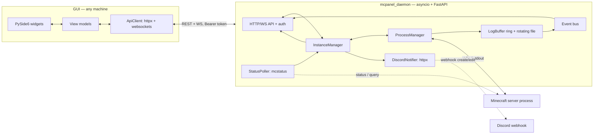
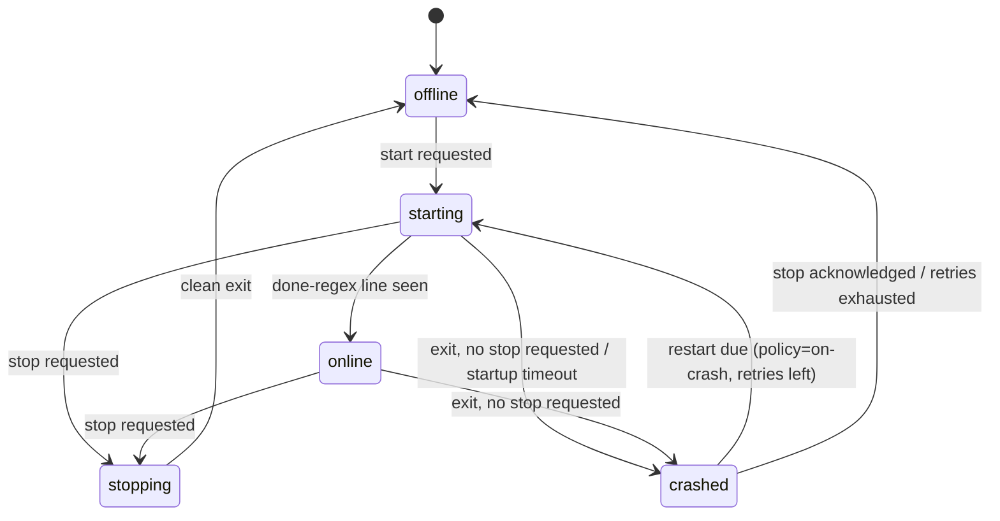

# mcpanel — Architecture

mcpanel manages Minecraft Java Edition servers. It has two parts:

1. **`mcpanel_daemon`** — a headless node daemon that runs on any host. It owns the
   Minecraft server process (stdin/stdout), probes its status, streams its console,
   and pushes state + recent logs to a Discord webhook. Everything the GUI needs
   lives here, so it keeps working when the GUI is closed.
2. **`mcpanel_gui`** — a PySide6 desktop client that manages one or many nodes
   (local or remote). It talks to the daemon **only** over HTTP/WebSocket. It never
   spawns, signals, or reads files of a Minecraft server. "Local" is just a node at
   `127.0.0.1` — no special case anywhere.

Both share `mcpanel_common`: pydantic models for the config schema and the API
contract (REST DTOs + WebSocket messages), plus the API version.

## Component diagram



## State machine

The process manager is an explicit state machine. Every transition goes through a
single `transition()` method, is logged, and is emitted on the event bus.



| From | Trigger | To | Notes |
|---|---|---|---|
| offline | start requested | starting | `create_subprocess_exec`, own process group (`start_new_session=True`), `stdout=PIPE`, `stderr=STDOUT` |
| starting | done line matches `done_regex` | online | default `Done \(\d+(\.\d+)?s\)! For help`, configurable |
| starting | stop requested | stopping | user stops during boot; graceful `stop` then escalation |
| starting | process exits, no stop requested | crashed | reason `crash_during_start` |
| starting | `startup_timeout` elapsed | crashed | reason `startup_timeout`; kill the process tree |
| online | stop requested | stopping | `requested_stop=True`; write `stop\n` to stdin |
| stopping | process exits | offline | clean stop |
| stopping | `stop_timeout` elapsed | stopping | escalate: SIGTERM to the group → wait → SIGKILL; `forced=True` |
| online | process exits, no stop requested | crashed | reason `crashed` |
| crashed | restart due | starting | policy `on-crash`, retries left, exponential backoff (capped) |
| crashed | `max_retries` exhausted | crashed (stable) | stop auto-restarting; emit `restart_loop` event + Discord post |
| crashed | stop acknowledged | offline | manual reset |

The crash counter resets once the instance has been online for
`reset_after_online_seconds` (default 600 s).

## Process state vs reachability vs combined state

The daemon tracks two separate facts in every snapshot, and derives a third:

- **`process.state`** — what the daemon manages (the state machine above).
- **`probe`** — what the mcstatus probe last saw (ok, latency, players, version, MOTD,
  error, timestamp). Probe errors never raise out of the poller loop.
- **`combined_state`** — what the GUI displays:

| process.state | last probe | combined_state |
|---|---|---|
| offline | — | offline |
| starting | any | starting |
| online | ok | online |
| online | failing < N consecutive | online (degraded) |
| online | failing ≥ N consecutive | unresponsive |
| stopping | any | stopping |
| crashed | any | crashed |

A probe failure while the process runs **never** reports `offline`.

## Data flows

- **Console**: subprocess stdout → log reader task → `LogBuffer` (in-memory ring,
  monotonic `seq` + timestamp per line) → teed to a rotating file under
  `data_dir/logs/<instance_id>.log` and fanned out over the event bus to console
  WebSocket subscribers. Slow clients get a bounded queue (128): on overflow the
  queue is dropped and a `resync` marker is sent; the client re-backfills over REST
  (`GET .../logs?since_seq=`).
- **Status**: per instance, every `status_poll_interval` seconds, `mcstatus`
  `async_status()` (plus `async_query()` when enabled) updates `probe` and the
  combined state; snapshots are broadcast over `/api/v1/events`.
- **Discord**: a per-instance task wakes `interval_seconds` after
  `first_push_delay_seconds`, builds an embed from the snapshot + last `log_lines`
  log lines, and creates (mode `edit-in-place`) or posts (mode `new-message`) it.
  Edit-in-place persists the Discord `message_id` in a state file under
  `data_dir/discord/`; a 404 on PATCH means the message was deleted → create anew.
  Immediate debounced posts on state changes (started/stopped/crashed/restart-loop).

## Concurrency model

- **Daemon**: one asyncio loop. Subprocess stdio via asyncio streams; probes via
  mcstatus async methods; Discord via `httpx.AsyncClient`; per-client bounded queues
  so no client can stall the server. No blocking calls.
- **GUI**: the Qt main thread only touches widgets. REST calls run on worker threads
  (`QThreadPool`); each WebSocket connection runs in its own `QThread`. View models
  are plain Python using QtCore signals only, so they are testable without a display
  (`QT_QPA_PLATFORM=offscreen`).

## Security model

- Daemon binds to `127.0.0.1` by default. Remote access is opt-in and documented
  (see `docs/remote-access.md`): SSH port-forward (recommended) or reverse proxy
  with TLS. RCON is never exposed by the API.
- Bearer-token auth on everything except `/health`; constant-time comparison
  (`hmac.compare_digest`). The token is either set in config or generated on first
  run into `data_dir/token` (mode 0600) and printed once.
- Secrets (`webhook_url`, token, RCON password) never appear in logs, error
  messages, UI text, or git. `SecretStr` prevents accidental repr/JSON leakage;
  config files written by the daemon are mode 0600; the webhook URL is write-only
  over the API (`webhook_set: bool` is all that comes back).
- Discord log hygiene: ANSI stripping, IP redaction (including the `/1.2.3.4:5678`
  login form), user-defined redaction regexes, line truncation, and a char budget
  (~1500 by default, well under Discord's 4096-char embed-description limit).
- WebSocket auth uses the `Authorization` header only — never `?token=` query
  strings, which leak into access logs. An invalid token is rejected at the
  handshake with an HTTP 401 denial (the same dependency guards REST and WS).

## Known limitations (documented, not hidden)

- If the daemon dies, its child servers die with it. Detached mode is a future
  option, not a first-pass feature.
- RCON-based TPS reporting is behind a feature flag and not implemented in the
  first pass; the config schema already reserves space for it.
- Server-list ping only reports players the server chooses to advertise; full
  player lists require `query_enabled` (and the server's `enable-query=true`).

## Repository layout

```
mcpanel/
├── pyproject.toml            # uv workspace root
├── config.example.toml       # full annotated daemon config
├── ARCHITECTURE.md           # this file
├── docs/
│   ├── openapi.json          # generated from the FastAPI app, committed (REST only:
│   │                         #   OpenAPI 3.0 can't express the WebSocket routes;
│   │                         #   the WS contract is the pydantic message models)
│   ├── remote-access.md      # SSH tunnel + reverse proxy (Phase 6)
│   └── discord.md            # Discord notifier behaviour (Phase 4)
├── packaging/
│   └── mcpanel-daemon.service  # systemd user unit example (Phase 7)
├── packages/
│   ├── mcpanel-common/       # pydantic models: config schema + API contract
│   ├── mcpanel-daemon/       # FastAPI daemon (process mgr, poller, notifier)
│   └── mcpanel-gui/          # PySide6 client (Phase 5)
└── tests/                    # one pytest run for the whole workspace
```
