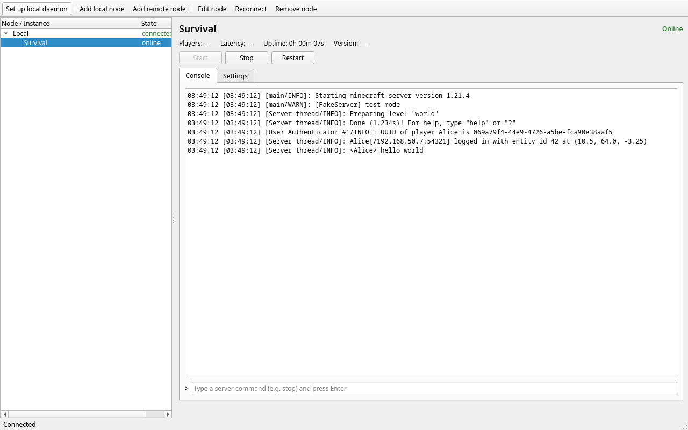
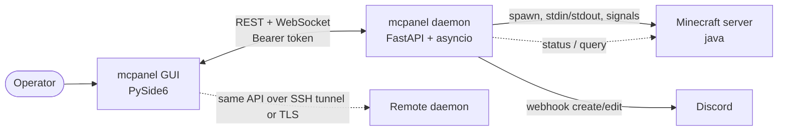

# mcpanel

**Run and monitor Minecraft Java Edition servers from a desktop app — on this
machine or a remote one — without keeping a terminal open or exposing RCON.**

[](LICENSE)
[](pyproject.toml)
[](packaging/build-linux.sh)



mcpanel is two pieces that ship as **one file**:

- **`mcpanel-daemon`** — a headless node daemon that owns the Minecraft
  process (stdin/stdout), probes status, streams the console, restarts crashes
  and pushes state + recent logs to Discord. It keeps working when the GUI is
  closed.
- **`mcpanel-gui`** — a PySide6 client that manages any number of nodes. It
  never touches a server process or file directly; it only talks to daemons
  over HTTP + WebSocket. "Local" is simply a daemon at `127.0.0.1`, so a
  tunneled remote node behaves identically.

## Download

Grab the latest all-in-one build from **[Releases](https://github.com/longme179/Minewrap/releases/latest)**:

```
mcpanel-x86_64.AppImage      (~93 MB, GUI + daemon in one file)
mcpanel-x86_64.AppImage.sha256
```

Requirements: Linux x86_64. Direct execution needs FUSE; on FUSE-less systems
run it with `--appimage-extract-and-run`.

```sh
chmod +x mcpanel-x86_64.AppImage
./mcpanel-x86_64.AppImage
```

## Quick start

1. Run the AppImage. On first launch the setup wizard opens automatically.
2. Pick your server directory and server jar (`-jar`), set JVM args such as
   `-Xmx4G` (and optional Discord webhook), then **Create & start**.
3. The wizard writes `~/mcpanel/config.toml`, starts the bundled daemon in the
   background (detached — it survives closing the GUI), reads the generated API
   token and connects the node.
4. Click the instance in the left tree: **Console** shows live logs and accepts
   server commands (`stop`, `list`, …); **Settings** edits launch/probe/restart
   and Discord options.

> mcpanel starts and owns its own server process. A server started by hand in
> a terminal is invisible to it — stop that first; two servers in the same
> world/port will conflict.

## Features

- **Server control** — start / stop / restart with explicit state machine,
  startup timeout, graceful `stop` → SIGTERM → SIGKILL escalation.
- **Live console** — ring-buffer backfill, streaming, command input with
  history, pause-on-scroll-up, slow-client resync.
- **Status** — process state and reachability kept separate; players, version,
  MOTD, latency and uptime from the server-list ping; optional Query for
  player names.
- **Crash policy** — restart on crash with exponential backoff and retry limits;
  a crash loop is reported instead of spamming.
- **Discord** — one message edited in place every N seconds (default 10 min)
  with state, players, version, latency, uptime and the last log lines; extra
  debounced posts on state changes. Redaction strips ANSI, login-form IPs and
  IPv4/IPv6 before anything leaves the machine.
- **Multi-node & remote** — manage many daemons; remote access via SSH
  port-forward (recommended) or a TLS reverse proxy.
- **Secrets stay secret** — bearer-token auth (constant-time compare), daemon
  binds `127.0.0.1` by default, token/config/state files are `0600`, webhooks
  are write-only over the API and never logged.

## How it works



Process state (`offline → starting → online → stopping → offline`, plus
`crashed`) is owned by the daemon. The probe result is a separate fact;
`online` requires the process to be up and the probe to succeed, and repeated
probe failures show **unresponsive** rather than "offline". See
[ARCHITECTURE.md](ARCHITECTURE.md) for the full design, state table and data
flows.

## Configuration

Everything is config-driven — no hardcoded paths, hosts, ports or Java
binaries. The daemon reads a TOML file; `config.example.toml` is fully
annotated. Minimal example:

```toml
[daemon]
host = "127.0.0.1"          # loopback by default
port = 8080
data_dir = "./data"         # tokens, Discord state, logs; relative to this file

[[instances]]
id = "survival"
name = "Survival"
work_dir = "/srv/minecraft/survival"
java_path = "java"
jvm_args = ["-Xmx4G"]
launch_args = ["-jar", "server.jar", "nogui"]
autostart = true

[instances.probe]
host = "127.0.0.1"
port = 25565

[instances.discord]
enabled = true
webhook_url = "https://discord.com/api/webhooks/…"
interval_seconds = 600
```

Settings edited in the GUI are validated, applied to the running daemon and
persisted back to the TOML file (`0600`).

Daemon data directory:

```
data/
├── token                  # generated API token (0600), printed once
├── daemon.log             # daemon + spawn diagnostics
├── logs/<instance>.log    # rotating console tee
└── discord/<instance>.json# edit-in-place message id
```

## Discord

Enable it per instance and paste the webhook URL in **Settings** (or the TOML
file), then use **Send test message**. The embed is colour-coded by state and
contains version, players, latency, uptime, last-updated and a fenced log
block. Edits use `PATCH`; if the message was deleted a new one is created.
Rate limits (429 `retry_after`) and 5xx responses are retried with backoff.
Full details: [docs/discord.md](docs/discord.md).

## Remote access

Keep the daemon on `127.0.0.1` and use one of:

- **SSH port-forward (recommended)** — `ssh -N -L 18080:127.0.0.1:8080 user@host`,
  then add a node with `http://127.0.0.1:18080` and the daemon token.
- **Reverse proxy with TLS** — Caddy or nginx in front of `127.0.0.1:8080`,
  WebSocket upgrade enabled.

RCON is never exposed. Setup commands and proxy configs:
[docs/remote-access.md](docs/remote-access.md).

## Build from source

Requires Python 3.12+ and [uv](https://docs.astral.sh/uv/).

```sh
uv sync --all-packages

# daemon
uv run mcpanel-daemon --config config.toml

# GUI (another terminal)
uv run mcpanel-gui
```

Quality gates:

```sh
uv run pytest            # 150+ tests, incl. fake Minecraft server & mock Discord
uv run ruff check        # lint
uv run pyright           # strict for mcpanel_common + mcpanel_daemon
```

The committed OpenAPI schema is generated from the real app:

```sh
uv run python -m mcpanel_daemon.openapi > docs/openapi.json
```

### Packaging (single-file AIO)

```sh
./packaging/build-linux.sh
```

Produces `dist/mcpanel-x86_64.AppImage` (GUI + daemon), a standalone
`dist/mcpanel-daemon` binary for servers, and a portable GUI folder. The
AppImage is the user-facing artifact; PyInstaller does not cross-compile, so
build Windows/macOS artifacts on those systems (the same specs apply).

## Project layout

```
packages/
├── mcpanel-common/   # pydantic models: config schema + API contract (shared)
├── mcpanel-daemon/   # FastAPI daemon: process manager, poller, Discord, API
└── mcpanel-gui/      # PySide6 client: ApiClient, view models, widgets
docs/                 # screenshot, OpenAPI schema, Discord + remote-access guides
packaging/            # PyInstaller specs, AppImage assets, systemd unit, build script
tests/                # one pytest run for the whole workspace
```

## Security

- Daemon listens on `127.0.0.1` by default; remote access is opt-in and
  documented with TLS or SSH.
- Bearer token on every endpoint except `/health`; constant-time comparison.
- Generated token and daemon-written configs are mode `0600`; the token is
  printed once on first run.
- Discord payloads redact ANSI codes, login-form IPs, IPv4/IPv6 addresses and
  user-defined patterns; the webhook URL is masked in every log line.
- The GUI stores node tokens in the OS keyring, falling back to a `0600` file.

## Known limitations

- If the daemon dies, its child servers die with it. Detached-mode supervision
  is a future option.
- RCON-based TPS reporting is reserved in the config but not implemented.
- The AppImage targets Linux x86_64; Windows/macOS builds are possible from
  source but not published.
- Player names require Query (`enable-query=true` in `server.properties`);
  console and status work without it.

## Documentation

| Document | Contents |
|---|---|
| [ARCHITECTURE.md](ARCHITECTURE.md) | components, state machine, data flows, concurrency |
| [docs/remote-access.md](docs/remote-access.md) | SSH tunnel and reverse-proxy TLS setups |
| [docs/discord.md](docs/discord.md) | embed contents, redaction, retries |
| [docs/openapi.json](docs/openapi.json) | committed API schema |
| [config.example.toml](config.example.toml) | every option, annotated |
| [packaging/mcpanel-daemon.service](packaging/mcpanel-daemon.service) | systemd user unit |

## License

MIT — see [LICENSE](LICENSE). Ideas were taken from the public projects listed
in the design notes; no code was copied.
