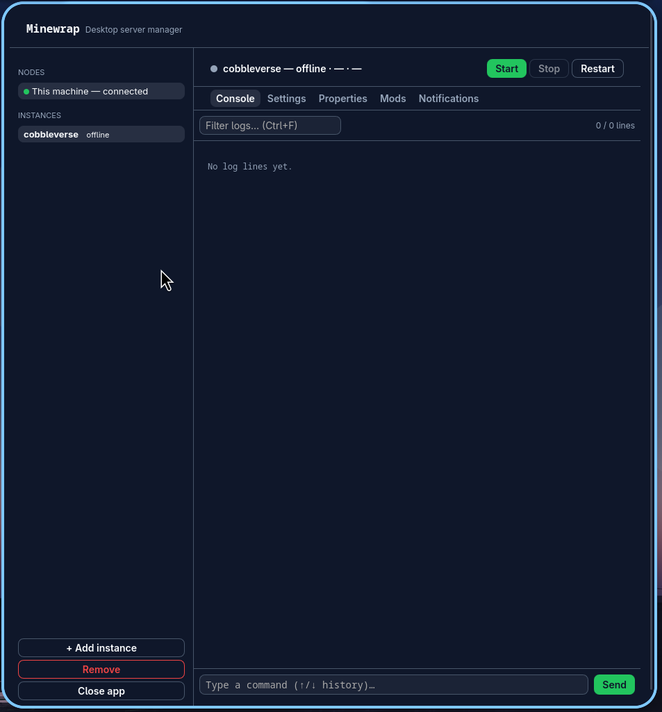
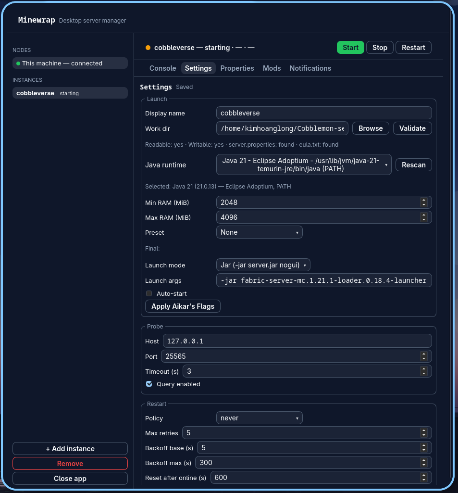
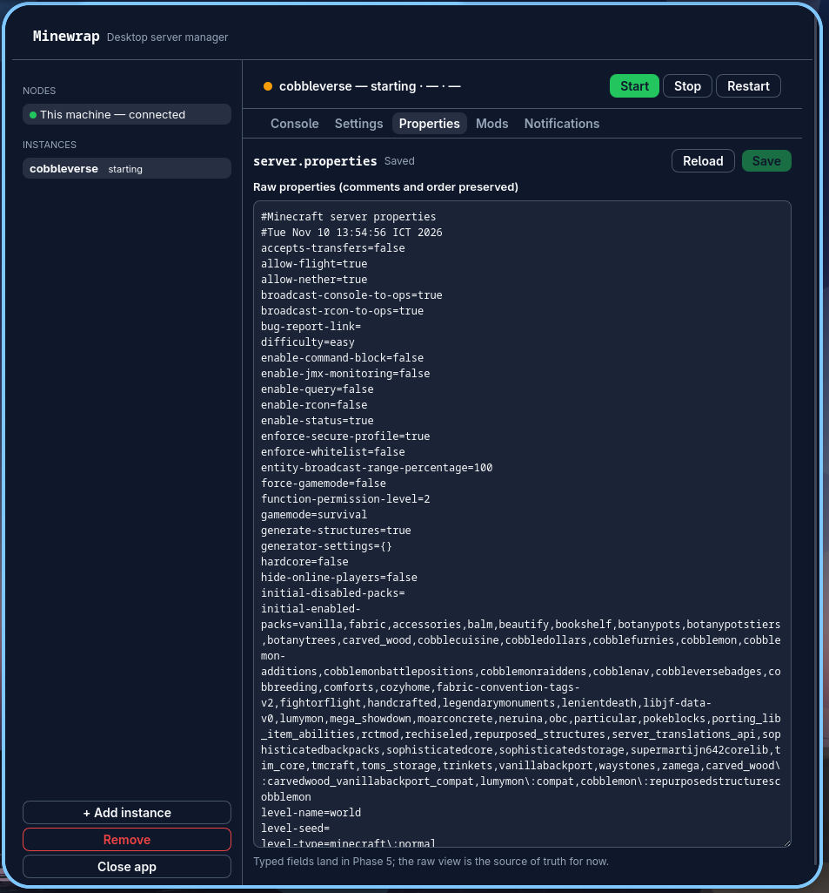
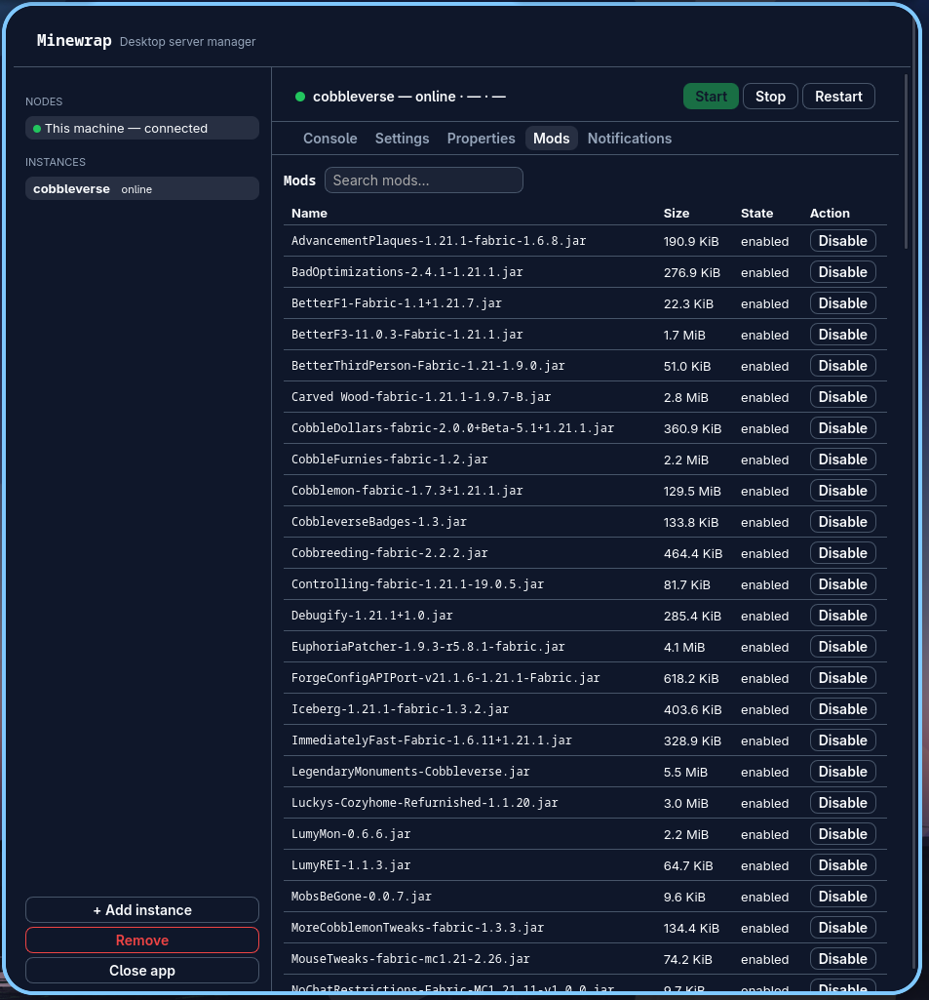
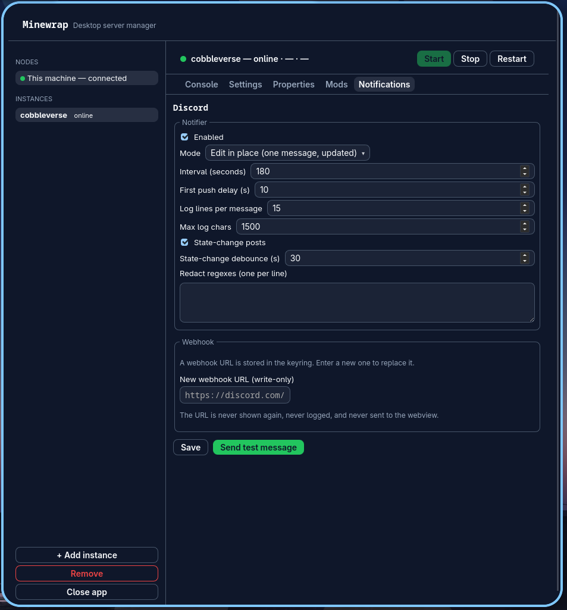
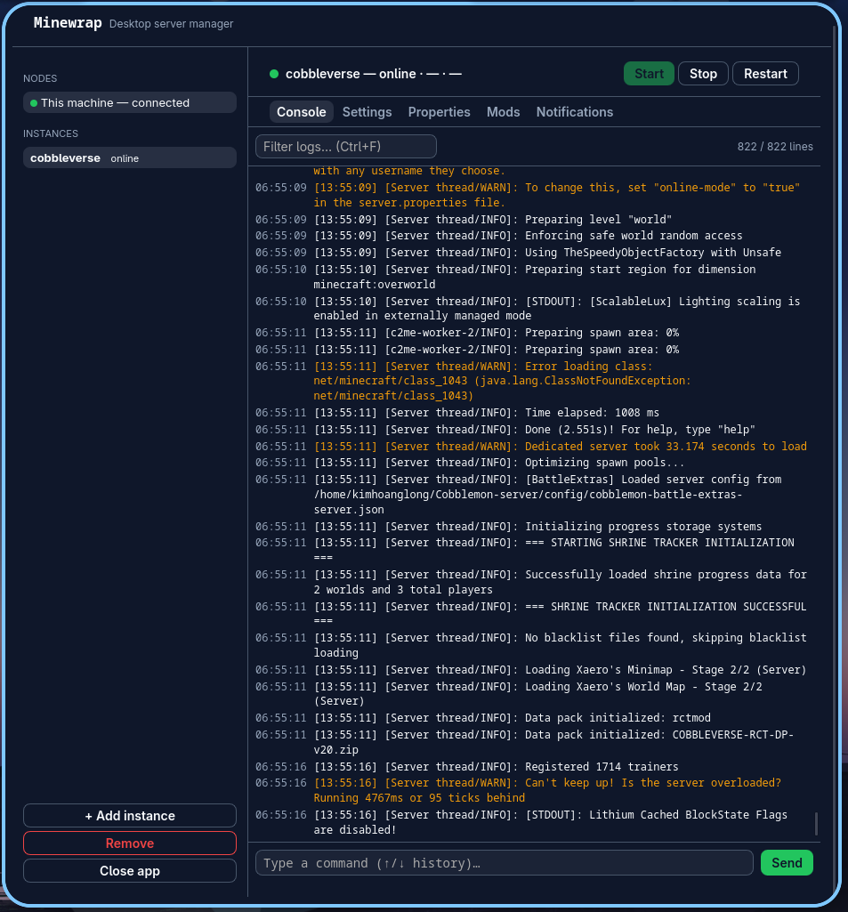

<p align="center">
  
</p>

# Minewrap

Fast, light desktop manager for Minecraft Java Edition servers (one or many, local or remote). A Tauri 2 + Svelte 5 app over a Tauri-free Rust core; the same core runs headless as `minewrapd` (axum REST+WebSocket) for always-on remote nodes and Discord posts.

**AppImage (Linux x86_64) is the primary distribution.** Prebuilt AppImages are published on [GitHub Releases](https://github.com/longme179/Minewrap/releases).

## Screenshots

| Console | Settings |
|:---:|:---:|
| <br>**Console** — live server logs, filtering, and command input | <br>**Settings** — launch mode, Java runtime, RAM, probe, restart policy |

| Properties | Mods |
|:---:|:---:|
| <br>**Properties** — edit `server.properties` directly, preserving comments and order | <br>**Mods** — search installed mods, see sizes, enable/disable |

| Notifications | Console (server online) |
|:---:|:---:|
| <br>**Notifications** — Discord webhook status posts with write-only URL storage | <br>**Console** — log stream backfill and live tail while the server runs |

## Quick start

### Run the AppImage
```bash
chmod +x Minewrap-x86_64.AppImage
./Minewrap-x86_64.AppImage
# On systems without FUSE:
./Minewrap-x86_64.AppImage --appimage-extract-and-run
```

### Run from source (development)
```bash
# Build the UI
cd ui && pnpm install && pnpm build && cd ..

# Run the desktop app (requires WebKitGTK/libsoup dev headers; see docs/BUILD_APPIMAGE.md)
cargo run -p minewrap-tauri

# Run the headless daemon (binds 127.0.0.1:8080 by default)
cargo run -p minewrapd -- --config examples/minewrap.toml
```

See [`docs/BUILD_APPIMAGE.md`](docs/BUILD_APPIMAGE.md) for full AppImage build prerequisites and steps, and [`docs/remote-access.md`](docs/remote-access.md) for reaching a remote daemon over SSH port-forward.

## Repo layout

```
Cargo.toml             # Rust workspace
Cargo.lock             # locked Rust dependencies (reproducible builds)
crates/minewrap-core   # Tauri-free core: config, process, logs, poller, discord, properties, mods
crates/minewrapd       # headless axum daemon (REST + WS)
crates/minewrap-remote # reqwest client for remote nodes
src-tauri/             # Tauri desktop app
ui/                    # Vite + Svelte + TypeScript frontend
packaging/             # AppImage build script, AppRun/desktop, systemd unit
examples/              # example config
docs/                  # documentation
```

## Build checks

```bash
cargo build --workspace
cd ui && pnpm run check && pnpm build
```

## Docs

- [`docs/BUILD_APPIMAGE.md`](docs/BUILD_APPIMAGE.md) — build the AppImage (main product)
- [`ARCHITECTURE.md`](ARCHITECTURE.md) — architecture and config overview
- [`docs/remote-access.md`](docs/remote-access.md) — reaching a remote daemon
- [`docs/RELEASE_NOTES.md`](docs/RELEASE_NOTES.md) — release notes

## License

MIT — see [LICENSE](LICENSE).
